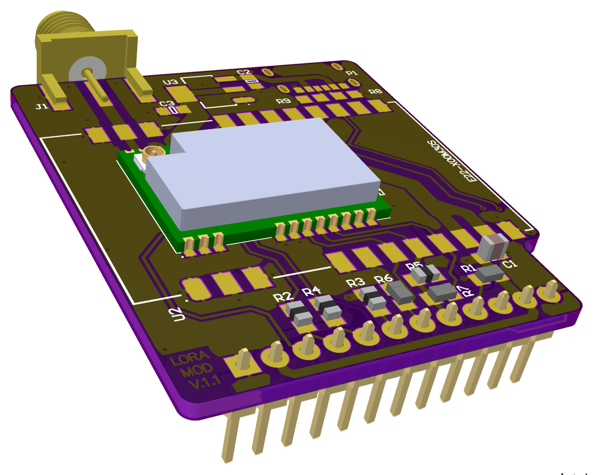
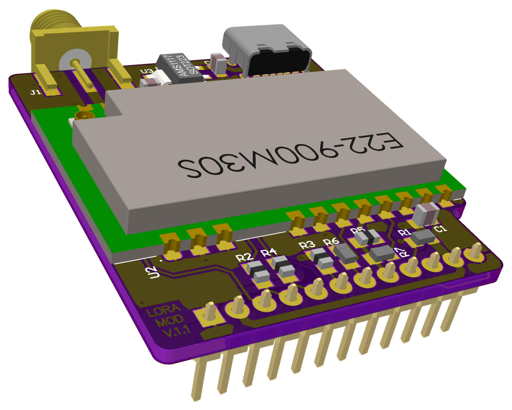
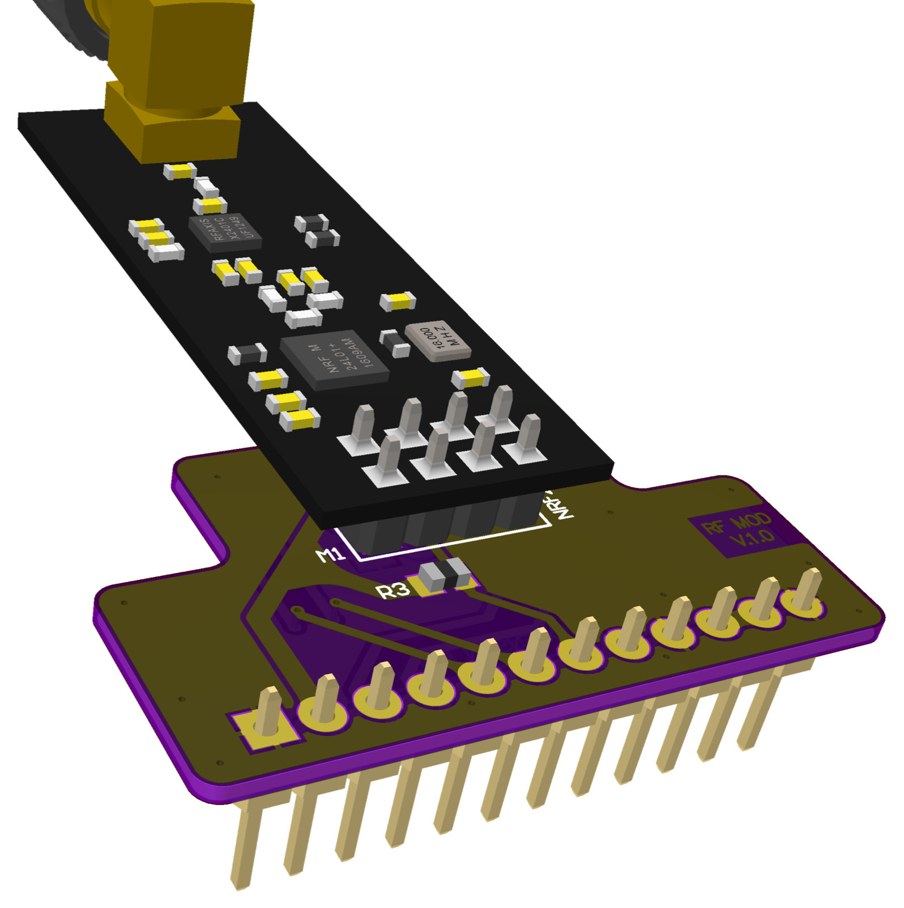
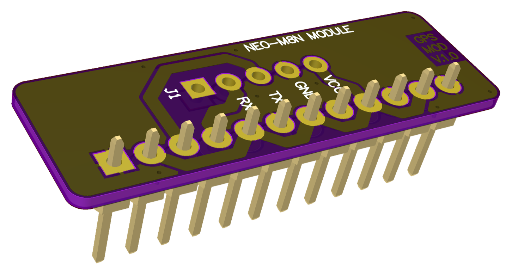
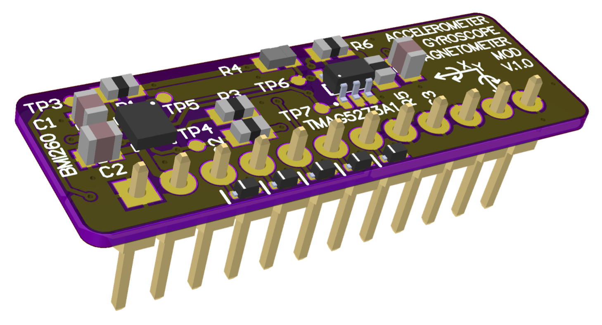
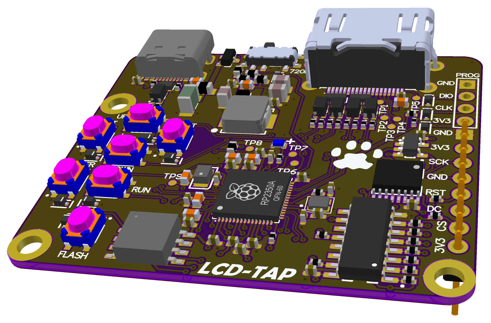
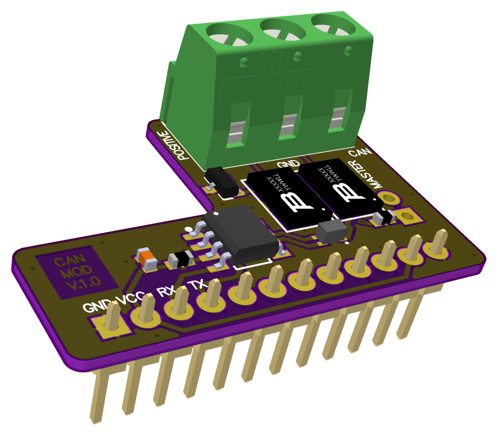

# Lilka extension modules

[Українська](README.uk.md) | **English**

Extension modules for [Lilka v2](https://docs.lilka.dev/) (ESP32-S3). Each module has its own
folder in [`modules/`](modules) with its README, pictures and example code. The examples are
self-tests you can run on the hardware: each one finds the module, checks its signal lines, makes
the chip do some real work, and prints a `PASS`/`FAIL` report to the USB serial port.

<table>
<tr>
<td align="center"><a href="modules/003_lora"><br><b>003 LORA</b></a><br>SX1262 / SX1268, 868 or 433 MHz</td>
<td align="center"><a href="modules/003_lora"><br><b>003 LORA (high power)</b></a><br>E22-900M30S</td>
<td align="center"><a href="modules/004_rf"><br><b>004 RF</b></a><br>nRF24L01+ / CC1101</td>
</tr>
<tr>
<td align="center"><a href="modules/005_gps"><br><b>005 GPS</b></a><br>u-blox NEO-M8N</td>
<td align="center"><a href="modules/006_gyro_magnet"><br><b>006 GYRO MAGNET</b></a><br>BMI260 + TMAG5273A1</td>
<td align="center"><a href="modules/007_lcd_tap"><br><b>007 LCD-TAP</b></a><br>Lilka screen → HDMI</td>
</tr>
<tr>
<td align="center"><a href="modules/008_can"><br><b>008 CAN</b></a><br>SN65HVD232</td>
<td></td>
<td></td>
</tr>
</table>

| Module | Chip | Code | Status |
|---|---|---|---|
| [003 LORA](modules/003_lora) | Ebyte E22-900M2xS (SX1262, 868/915 MHz) or E22-400M2xS (SX1268, 433 MHz) | [`main.cpp`](modules/003_lora/main.cpp) | REV01 with E22-900M22S tested on hardware |
| [004 RF](modules/004_rf) | nRF24L01+PA+LNA or CC1101 (nRF24 layout) | [`nrf24`](modules/004_rf/nrf24/main.cpp), [`cc1101`](modules/004_rf/cc1101/main.cpp) | Tested on hardware with both modules |
| [005 GPS](modules/005_gps) | u-blox NEO-M8N | — | Not tested yet |
| [006 GYRO MAGNET](modules/006_gyro_magnet) | Bosch BMI260 + TI TMAG5273A1 | [`main.cpp`](modules/006_gyro_magnet/main.cpp) | Tested on hardware; `GYR_INT2` gave no pulses, cause not found yet |
| [007 LCD-TAP](modules/007_lcd_tap) | RP2350A | [`lcdtap`](modules/007_lcd_tap) (submodule) | Connects to the display bus, not the extension connector |
| [008 CAN](modules/008_can) | TI SN65HVD232 | — | Not tested yet |

## Extension connector

Every module except LCD-TAP plugs into the 12-pin Lilka v2 extension connector. The pin numbers
below are those of connector J2 in the module schematics; the tests on the LoRa, RF and GYRO
MAGNET boards confirmed them.

| Pin | Signal | Pin | Signal |
|---|---|---|---|
| 1 | GND | 7 | GPIO21 |
| 2 | 3V3 | 8 | GPIO14 |
| 3 | GPIO44 (U0RXD) | 9 | GPIO13 |
| 4 | GPIO43 (U0TXD) | 10 | GPIO12 |
| 5 | GPIO48 | 11 | 3V3 |
| 6 | GPIO47 | 12 | GND |

`lilka::board.getExtPinGPIO()` in the SDK uses a different index order (indexes 2–7 are
GPIO48…12, 8 is TX, 9 is RX). Don't mix the two numberings.

### Pins wired straight to GND or 3V3

Some boards connect header pins directly to GND or 3V3. **Never configure these GPIOs as
outputs** while that module is plugged in: driving one would short the supply.

| Module | Pins wired straight to a supply |
|---|---|
| 004 RF | GPIO13 → GND, GPIO12 → 3V3 |
| 005 GPS | GPIO48, 21, 13 → 3V3; GPIO47, 14, 12 → GND |
| 006 GYRO MAGNET | GPIO14, 13, 12 → GND |

## Build and run

Requirements: [PlatformIO](https://platformio.org/) and a Lilka v2 connected over USB.

```bash
git clone --recursive <this repository>   # --recursive also fetches LCD-TAP
pio run                                   # build every example
pio run -e lora_sx1262 -t upload          # flash one: lora_sx1262, lora_433, rf_nrf24, rf_cc1101, gyro_magnet
pio device monitor                        # watch the report (115200 baud)
```

Serial commands: `t` reruns the self-test, `k` boots back into the app in the `app0` slot (Keira).

> **Note.** `-t upload` writes the example over the whole flash layout (bootloader, partition table
> and app), replacing Keira. To keep Keira, flash the example into a free OTA slot instead (for
> example `app1` at `0x410000` in the Keira partition table) and select that slot in `otadata`.
> The `k` command then switches back to Keira.

## RF safety

The LoRa and CC1101 examples transmit at about 0 dBm. Attach an antenna before running them
anyway. Make sure the frequencies you use are allowed where you are: 433.05–434.79 MHz and
863–870 MHz are licence-free short-range bands in Ukraine and the EU, with duty-cycle limits.

## Third-party code

- [`modules/006_gyro_magnet/bmi260_config`](modules/006_gyro_magnet/bmi260_config): the BMI260
  initialisation blob by Bosch Sensortec (BSD-3-Clause, see its `LICENSE`), taken from the
  ChromiumOS EC `third_party/bmi260` copy.
- [`modules/007_lcd_tap/lcdtap`](modules/007_lcd_tap): [lilka-dev/lcdtap](https://github.com/lilka-dev/lcdtap),
  a fork of [shapoco/lcdtap](https://github.com/shapoco/lcdtap) (MIT).
