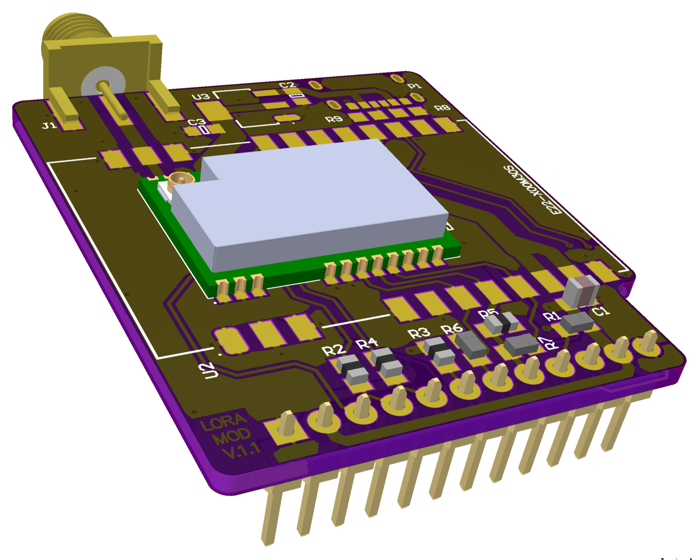
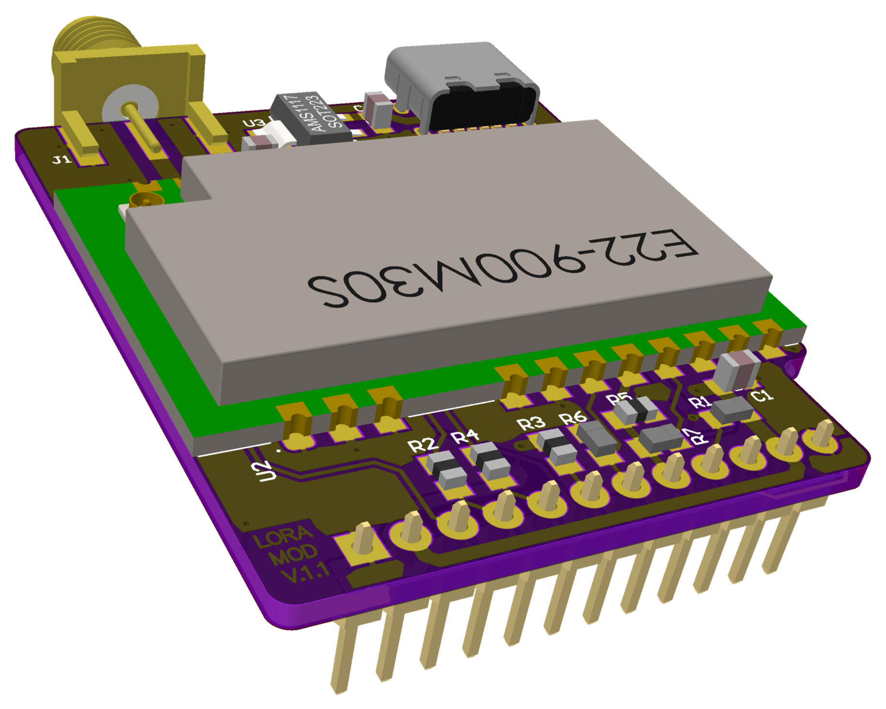
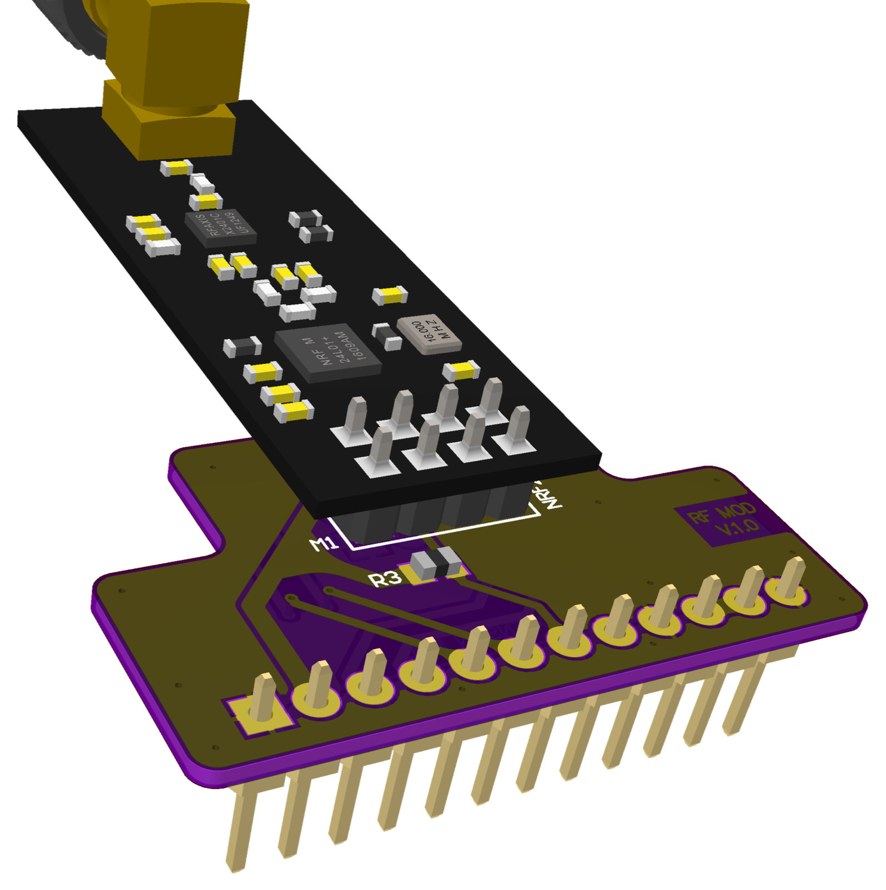
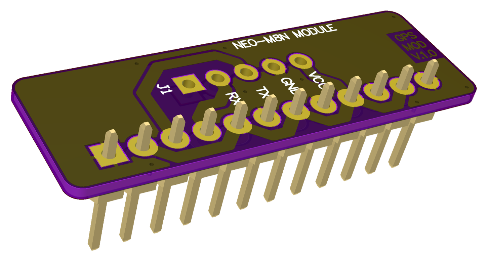
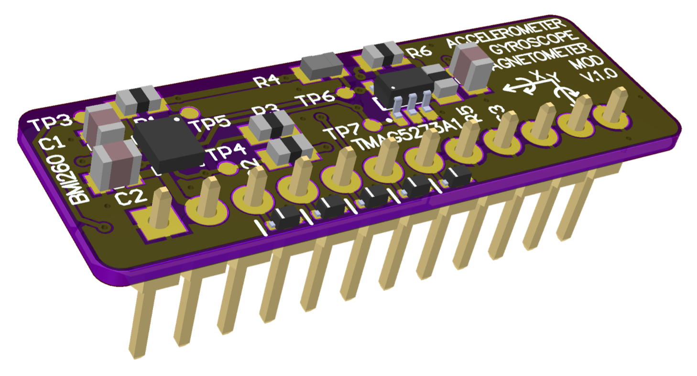
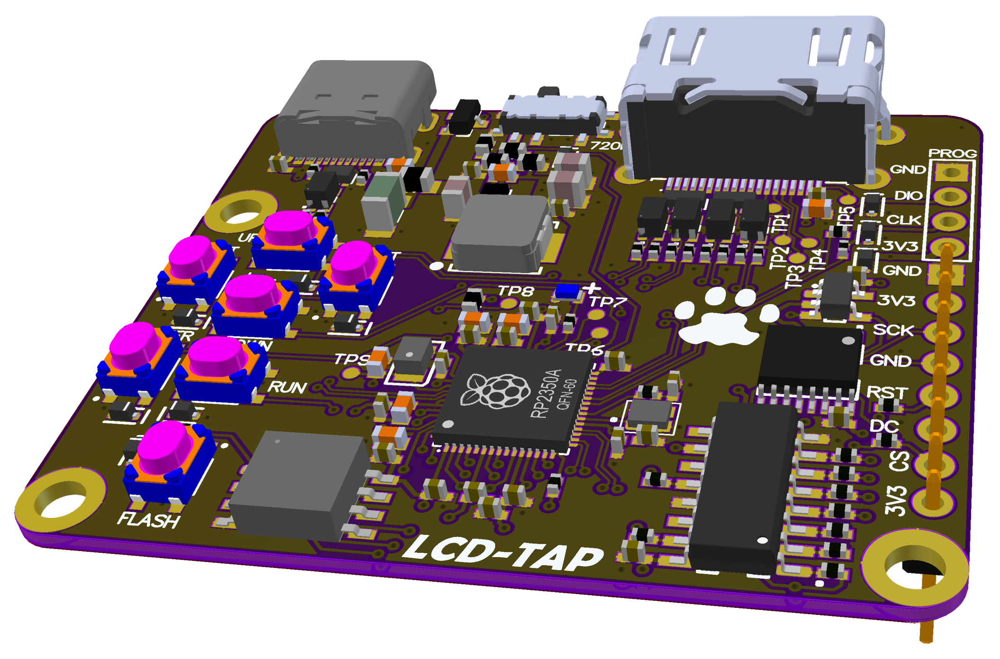
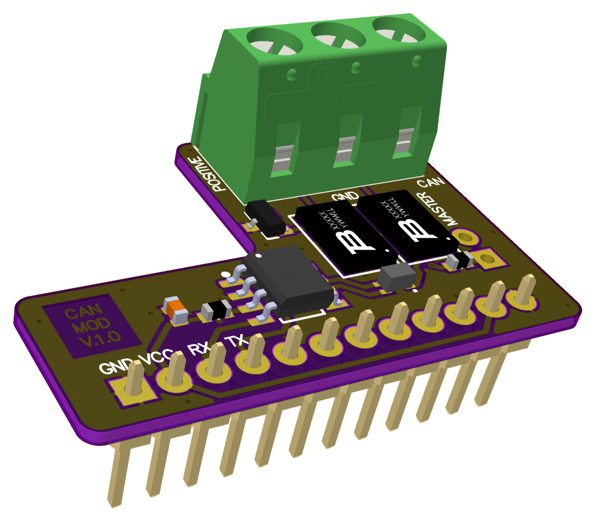

# Модулі розширення Лілки

**Українська** | [English](README.md)

Модулі розширення для [Лілки v2](https://docs.lilka.dev/) (ESP32-S3). Кожен модуль має власну
папку в [`modules/`](modules) з README, зображеннями та кодом прикладу. Приклади — це самотести,
які запускаються на залізі: кожен знаходить модуль, перевіряє його сигнальні лінії, змушує
мікросхему виконати реальну роботу й виводить звіт `PASS`/`FAIL` у USB-серійний порт.

<table>
<tr>
<td align="center"><a href="modules/003_lora/README.uk.md"><br><b>003 LORA</b></a><br>SX1262 / SX1268, 868 або 433 МГц</td>
<td align="center"><a href="modules/003_lora/README.uk.md"><br><b>003 LORA (велика потужність)</b></a><br>E22-900M30S</td>
<td align="center"><a href="modules/004_rf/README.uk.md"><br><b>004 RF</b></a><br>nRF24L01+ / CC1101</td>
</tr>
<tr>
<td align="center"><a href="modules/005_gps/README.uk.md"><br><b>005 GPS</b></a><br>u-blox NEO-M8N</td>
<td align="center"><a href="modules/006_gyro_magnet/README.uk.md"><br><b>006 GYRO MAGNET</b></a><br>BMI260 + TMAG5273A1</td>
<td align="center"><a href="modules/007_lcd_tap/README.uk.md"><br><b>007 LCD-TAP</b></a><br>екран Лілки → HDMI</td>
</tr>
<tr>
<td align="center"><a href="modules/008_can/README.uk.md"><br><b>008 CAN</b></a><br>SN65HVD232</td>
<td></td>
<td></td>
</tr>
</table>

| Модуль | Мікросхема | Код | Стан |
|---|---|---|---|
| [003 LORA](modules/003_lora/README.uk.md) | Ebyte E22-900M2xS (SX1262, 868/915 МГц) або E22-400M2xS (SX1268, 433 МГц) | [`main.cpp`](modules/003_lora/main.cpp) | REV01 з E22-900M22S перевірено на залізі |
| [004 RF](modules/004_rf/README.uk.md) | nRF24L01+PA+LNA або CC1101 (розпиновування nRF24) | [`nrf24`](modules/004_rf/nrf24/main.cpp), [`cc1101`](modules/004_rf/cc1101/main.cpp) | Перевірено на залізі з обома модулями |
| [005 GPS](modules/005_gps/README.uk.md) | u-blox NEO-M8N | — | Ще не перевіряли |
| [006 GYRO MAGNET](modules/006_gyro_magnet/README.uk.md) | Bosch BMI260 + TI TMAG5273A1 | [`main.cpp`](modules/006_gyro_magnet/main.cpp) | Перевірено на залізі; `GYR_INT2` не дав імпульсів, причину ще не знайдено |
| [007 LCD-TAP](modules/007_lcd_tap/README.uk.md) | RP2350A | [`lcdtap`](modules/007_lcd_tap) (сабмодуль) | Під'єднується до шини дисплея, а не до роз'єму розширення |
| [008 CAN](modules/008_can/README.uk.md) | TI SN65HVD232 | — | Ще не перевіряли |

## Роз'єм розширення

Усі модулі, крім LCD-TAP, вставляються в 12-контактний роз'єм розширення Лілки v2. Номери
контактів нижче — це номери роз'єму J2 на схемах модулів; тести плат LoRa, RF і GYRO MAGNET їх
підтвердили.

| Контакт | Сигнал | Контакт | Сигнал |
|---|---|---|---|
| 1 | GND | 7 | GPIO21 |
| 2 | 3V3 | 8 | GPIO14 |
| 3 | GPIO44 (U0RXD) | 9 | GPIO13 |
| 4 | GPIO43 (U0TXD) | 10 | GPIO12 |
| 5 | GPIO48 | 11 | 3V3 |
| 6 | GPIO47 | 12 | GND |

`lilka::board.getExtPinGPIO()` у SDK використовує інший порядок індексів (індекси 2–7 — це
GPIO48…12, 8 — TX, 9 — RX). Не змішуйте ці дві нумерації.

### Контакти, з'єднані напряму з GND або 3V3

Деякі плати з'єднують контакти роз'єму напряму з GND або 3V3. **Ніколи не налаштовуйте ці GPIO як
виходи**, поки такий модуль вставлено: це закоротить живлення.

| Модуль | Контакти, з'єднані напряму з живленням |
|---|---|
| 004 RF | GPIO13 → GND, GPIO12 → 3V3 |
| 005 GPS | GPIO48, 21, 13 → 3V3; GPIO47, 14, 12 → GND |
| 006 GYRO MAGNET | GPIO14, 13, 12 → GND |

## Збирання і запуск

Потрібні [PlatformIO](https://platformio.org/) і Лілка v2, під'єднана по USB.

```bash
git clone --recursive <цей репозиторій>   # --recursive також завантажить LCD-TAP
pio run                                   # зібрати всі приклади
pio run -e lora_sx1262 -t upload          # прошити один: lora_sx1262, lora_433, rf_nrf24, rf_cc1101, gyro_magnet
pio device monitor                        # дивитися звіт (115200 бод)
```

Команди в серійному порту: `t` — запустити самотест ще раз, `k` — завантажити застосунок зі
слоту `app0` (Keira).

> **Увага.** `-t upload` перезаписує всю розмітку флеш-пам'яті (завантажувач, таблицю розділів і
> застосунок), тож Keira зникне. Щоб зберегти Keira, прошийте приклад у вільний OTA-слот
> (наприклад, `app1` за адресою `0x410000` у таблиці розділів Keira) і виберіть цей слот в
> `otadata`. Тоді команда `k` поверне Keira.

## Безпека радіопередачі

Приклади для LoRa і CC1101 передають приблизно на 0 дБм. Однаково під'єднуйте антену перед
запуском. Переконайтеся, що ваші частоти дозволені там, де ви перебуваєте: 433,05–434,79 МГц і
863–870 МГц — це смуги для пристроїв малого радіуса дії без ліцензії в Україні та ЄС, з
обмеженнями на коефіцієнт заповнення.

## Сторонній код

- [`modules/006_gyro_magnet/bmi260_config`](modules/006_gyro_magnet/bmi260_config): блок
  ініціалізації BMI260 від Bosch Sensortec (BSD-3-Clause, див. його `LICENSE`), узятий з копії
  `third_party/bmi260` у ChromiumOS EC.
- [`modules/007_lcd_tap/lcdtap`](modules/007_lcd_tap): [lilka-dev/lcdtap](https://github.com/lilka-dev/lcdtap),
  форк [shapoco/lcdtap](https://github.com/shapoco/lcdtap) (MIT).
