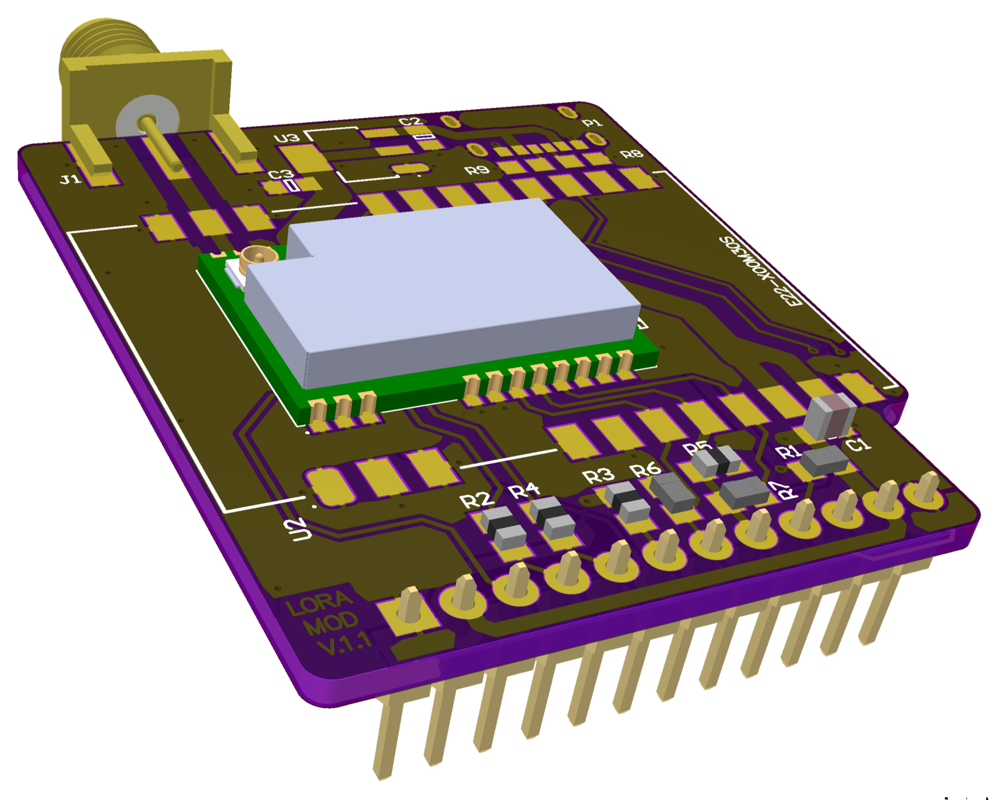
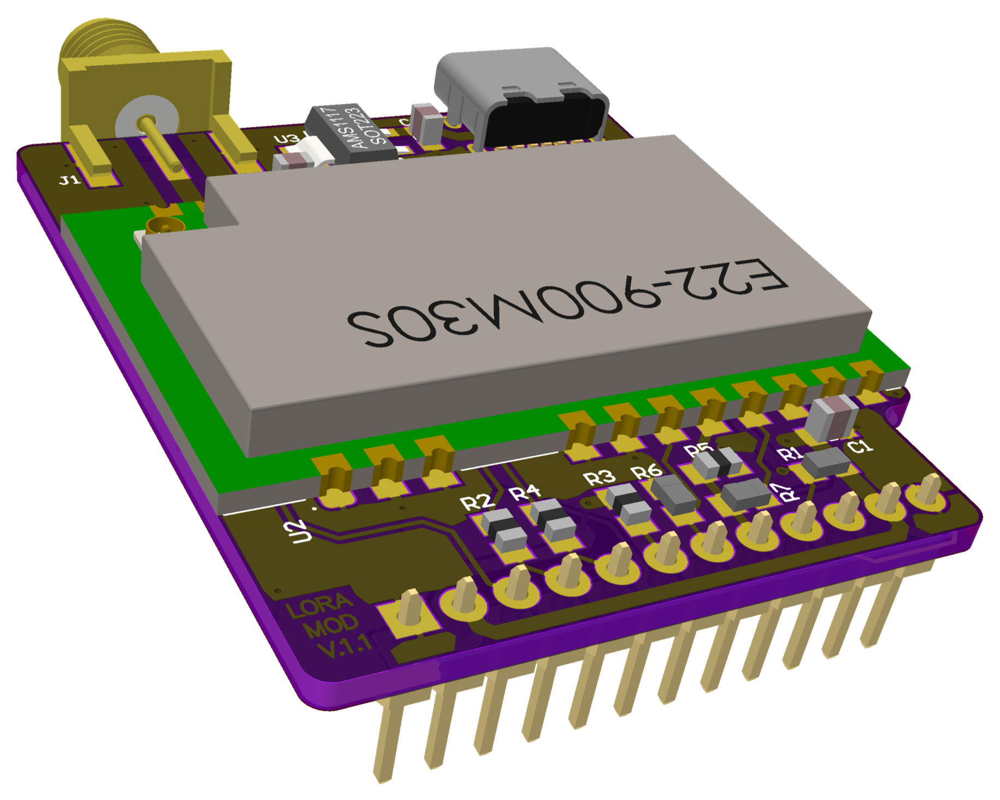

# 003 LILKA MOD LORA

[Українська](README.uk.md) | **English** · [All modules](../../README.md)

| Low power (E22-900M22S) | High power (E22-900M30S) |
|---|---|
|  |  |

A sub-GHz LoRa / FSK radio for Lilka v2, built on an Ebyte E22 module and an SMA antenna
connector. The board takes E22 modules for either band; they share the same package and pinout:

| Band | Module | Chip | Range |
|---|---|---|---|
| 868/915 MHz | E22-900M22S (22 dBm), E22-900M30S (30 dBm) | SX1262 | 850–930 MHz |
| 433 MHz | E22-400M22S (22 dBm), E22-400M30S (30 dBm) | SX1268 | 410–493 MHz |

Use an antenna made for the module's band.

| Revision | Module | Status |
|---|---|---|
| REV01 | E22-900M22S (up to 22 dBm) | Tested with [`main.cpp`](main.cpp) |
| REV02 low power | E22-900M22S | Not tested yet |
| REV02 high power | E22-900M30S (up to 30 dBm), with USB-C and an AMS1117 regulator on board | Not tested yet |
| Any revision, 433 MHz | E22-400M22S / E22-400M30S | Not tested yet |

## Pinout (REV01)

| Header pin | Lilka GPIO | Signal | On the board |
|---|---|---|---|
| 1, 12 | GND | GND | |
| 2, 11 | 3V3 | VCC | |
| 3 | 44 | SCK | |
| 4 | 43 | MISO | 390 Ω series resistor |
| 5 | 48 | MOSI | 390 Ω series resistor |
| 6 | 47 | NSS | 10k pull-up |
| 7 | 21 | RXEN | 10k pull-down |
| 8 | 14 | TXEN | 10k pull-down |
| 9 | 13 | NRST | 10k pull-up |
| 10 | 12 | BUSY | |

## Notes for software

- `DIO1` is not connected, so read the IRQ status over SPI (`GetIrqStatus`) instead of waiting for
  an interrupt.
- The module has a TCXO. Call `SetDIO3AsTcxoCtrl(1.8 V)` before calibrating, otherwise you get
  `XOSC_START_ERR`.
- The RF switch is driven by the MCU: set `RXEN = 1, TXEN = 0` to receive and `RXEN = 0, TXEN = 1`
  to transmit. `DIO2` can drive TXEN through R7, but R7 is not fitted.
- When using RadioLib, pass `RADIOLIB_NC` for DIO1 and poll the IRQ status yourself. Use the
  `SX1262` class for E22-900 modules and `SX1268` for E22-400 modules.
- The SX1268 uses the same commands as the SX1262. For the 433 MHz band, run image calibration for
  430–440 MHz (`CalibrateImage(0x6B, 0x6F)`) instead of 863–870 MHz (`0xD7, 0xDB`).

## Example

[`main.cpp`](main.cpp) runs a self-test:
- SPI link, reset/BUSY, and buffer write/read-back
- TCXO calibration
- RX noise floor at the working frequency
- a 0 dBm TX, checked for time-on-air

It then sends a beacon every 10 s (SF7, BW125) and prints every packet it receives.

```bash
pio run -e lora_sx1262 -t upload && pio device monitor   # E22-900: 868.1 MHz
pio run -e lora_433    -t upload && pio device monitor   # E22-400: 433.175 MHz
```

To use another frequency, build with `-DLORA_FREQ_HZ=<Hz>`.

Result on a REV01 board with an E22-900M22S: all checks passed, noise floor −108.5 dBm,
time-on-air 52 ms.
