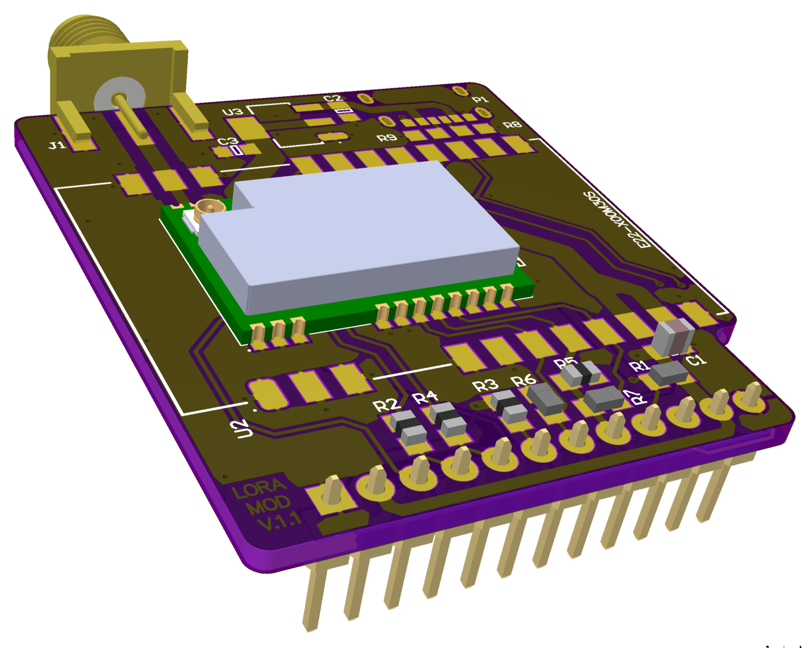
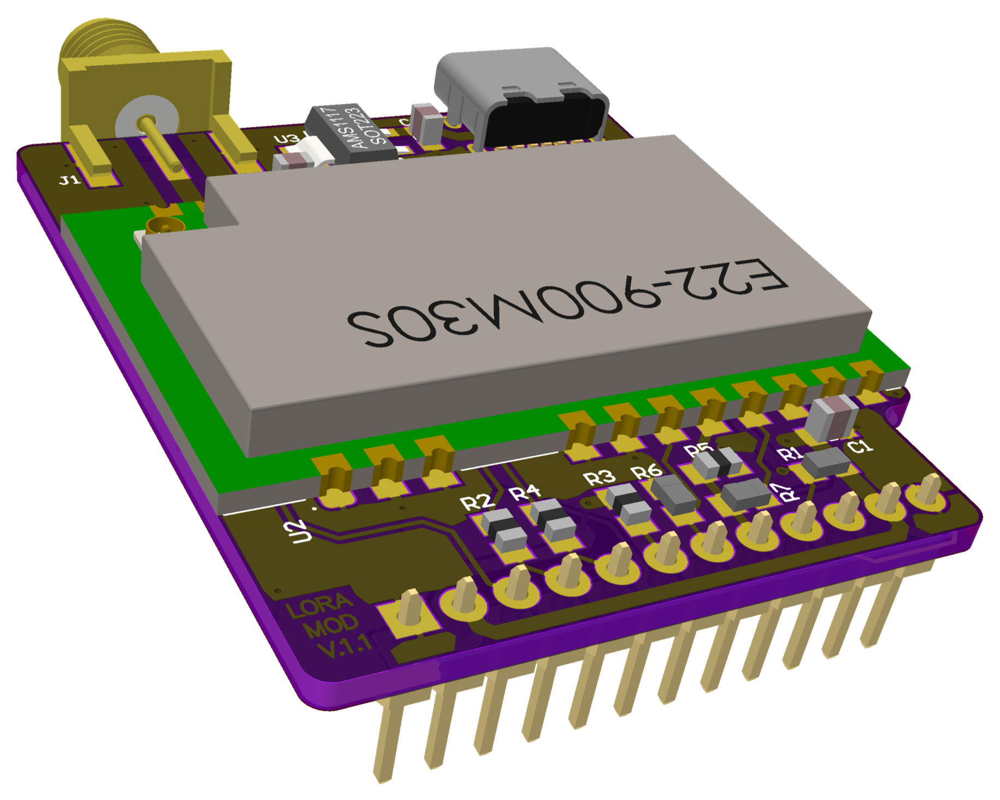

# 003 LILKA MOD LORA

**Українська** | [English](README.md) · [Усі модулі](../../README.uk.md)

| Мала потужність (E22-900M22S) | Велика потужність (E22-900M30S) |
|---|---|
|  |  |

Суб-ГГц радіомодуль LoRa / FSK для Лілки v2 на модулі Ebyte із Semtech SX1262 всередині
(850–930 МГц) і роз'ємом SMA для антени.

| Ревізія | Модуль | Стан |
|---|---|---|
| REV01 | E22-900M22S (до 22 дБм) | Перевірено прикладом [`main.cpp`](main.cpp) |
| REV02, мала потужність | E22-900M22S | Ще не перевіряли |
| REV02, велика потужність | E22-900M30S (до 30 дБм), з USB-C і стабілізатором AMS1117 на платі | Ще не перевіряли |

## Розпиновування (REV01)

| Контакт роз'єму | GPIO Лілки | Сигнал | На платі |
|---|---|---|---|
| 1, 12 | GND | GND | |
| 2, 11 | 3V3 | VCC | |
| 3 | 44 | SCK | |
| 4 | 43 | MISO | послідовно 390 Ом |
| 5 | 48 | MOSI | послідовно 390 Ом |
| 6 | 47 | NSS | підтяжка 10k до 3V3 |
| 7 | 21 | RXEN | підтяжка 10k до GND |
| 8 | 14 | TXEN | підтяжка 10k до GND |
| 9 | 13 | NRST | підтяжка 10k до 3V3 |
| 10 | 12 | BUSY | |

## Для програмістів

- `DIO1` не під'єднано, тому стан переривань читайте через SPI (`GetIrqStatus`), а не чекайте на
  переривання.
- У модулі є TCXO. Перед калібруванням викличте `SetDIO3AsTcxoCtrl(1,8 В)`, інакше отримаєте
  `XOSC_START_ERR`.
- ВЧ-перемикачем керує мікроконтролер: для прийому `RXEN = 1, TXEN = 0`, для передачі
  `RXEN = 0, TXEN = 1`. `DIO2` може керувати TXEN через R7, але R7 не встановлено.
- У RadioLib передавайте `RADIOLIB_NC` замість DIO1 і опитуйте стан переривань самостійно.

## Приклад

[`main.cpp`](main.cpp) виконує самотест:
- зв'язок по SPI, скидання/BUSY, запис і зворотне читання буфера
- калібрування з TCXO
- рівень шуму на прийомі на 868,1 МГц
- передачу на 0 дБм із перевіркою часу в ефірі

Далі він щоразу через 10 с передає маячок (868,1 МГц, SF7, BW125) і виводить усі прийняті пакети.

```bash
pio run -e lora_sx1262 -t upload && pio device monitor
```

Результат на платі REV01: усі перевірки пройдено, рівень шуму −108,5 дБм, час в ефірі 52 мс.
