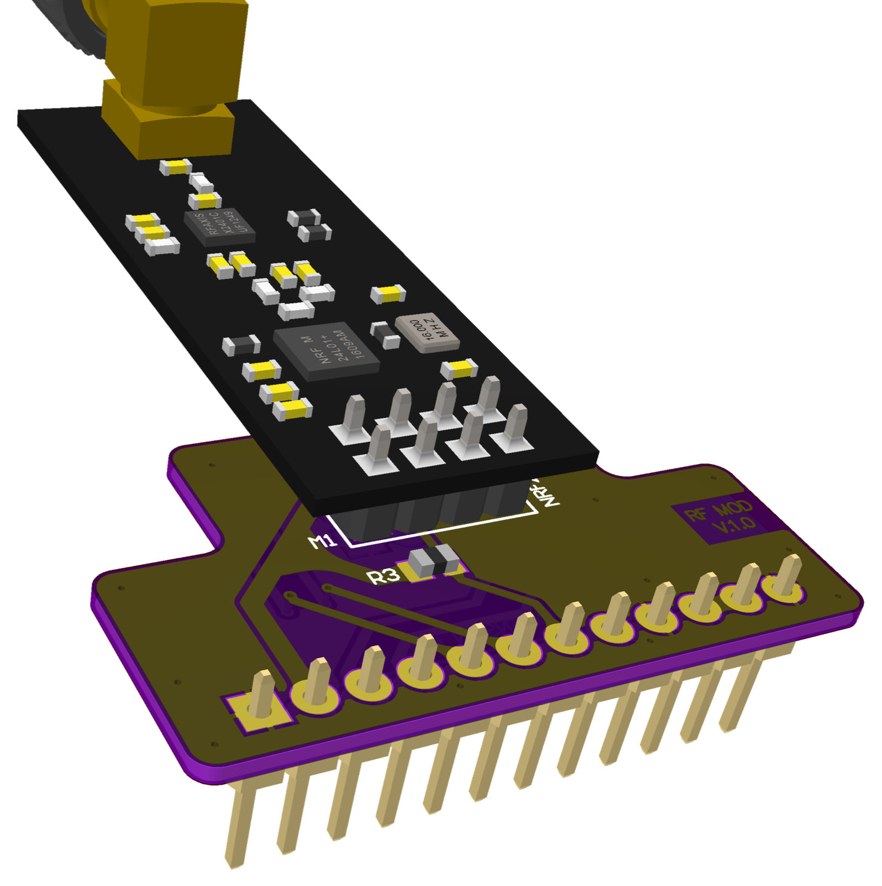
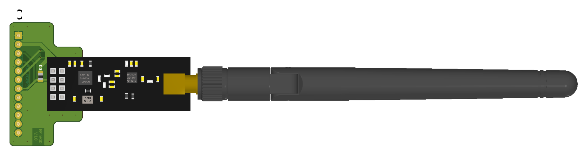

# 004 LILKA MOD RF

[Українська](README.uk.md) | **English** · [All modules](../../README.md)

<br>


A carrier board for 8-pin (2×4, 2.54 mm) radio modules that use the common nRF24L01 layout. It
was tested with two kinds of module:

| Module | Band | Code | Status |
|---|---|---|---|
| nRF24L01+PA+LNA | 2.4 GHz | [`nrf24/main.cpp`](nrf24/main.cpp) | Tested on hardware |
| CC1101, nRF24 layout | 300–348 / 387–464 / 779–928 MHz | [`cc1101/main.cpp`](cc1101/main.cpp) | Tested on hardware |

## Pinout

| Header pin | Lilka GPIO | Carrier signal | nRF24L01+ | CC1101 | On the board |
|---|---|---|---|---|---|
| 1, 12 | GND | GND | GND | GND | |
| 2, 11 | 3V3 | VCC | VCC | VCC | |
| 3 | 44 | RF_SCK | SCK | SCK | |
| 4 | 43 | RF_MISO | MISO | MISO / GDO1 | |
| 5 | 48 | RF_MOSI | MOSI | MOSI | |
| 6 | 47 | RF_CS# | CSN | CSN | 10k pull-up |
| 7 | 21 | RF_RX/TX_ENABLE | CE | GDO0 | 10k pull-up |
| 8 | 14 | RF_IRQ# | IRQ | GDO2 | 10k pull-up |
| 9 | 13 | — | — | — | **wired to GND** |
| 10 | 12 | — | — | — | **wired to 3V3** |

**Never configure GPIO13 or GPIO12 as outputs** while this board is plugged in: driving them
shorts the supply.

## Notes for software

- **nRF24L01+:** the `RPD` register (carrier above −64 dBm at the chip) is a quick way to check the
  receiver.
- **CC1101:** the module we tested reads `PARTNUM = 0x00`, `VERSION = 0x14`. GDO0 and GDO2 can be
  mapped to any signal through `IOCFG0`/`IOCFG2`. The examples assume a 26 MHz crystal, the usual
  value on these modules. Check yours before relying on exact frequencies.
- With RF24 or RadioLib: CE/GDO0 = 21, CSN = 47, IRQ/GDO2 = 14, and the SPI bus on SCK 44,
  MISO 43, MOSI 48.

## Examples

```bash
pio run -e rf_nrf24  -t upload && pio device monitor
pio run -e rf_cc1101 -t upload && pio device monitor
```

- **[`nrf24`](nrf24/main.cpp):** checks the board's idle pin levels, SPI and register read-back,
  then one TX including the IRQ line. To check the receiver without a second radio, the ESP32-S3
  transmits Wi-Fi frames on channel 13 while the nRF24 looks for the carrier around 2472 MHz.
- **[`cc1101`](cc1101/main.cpp):** checks `PARTNUM`/`VERSION`, register read-back, both GDO lines,
  then the PLL, RX noise floor and one TX at 433.92 and 868.30 MHz.
