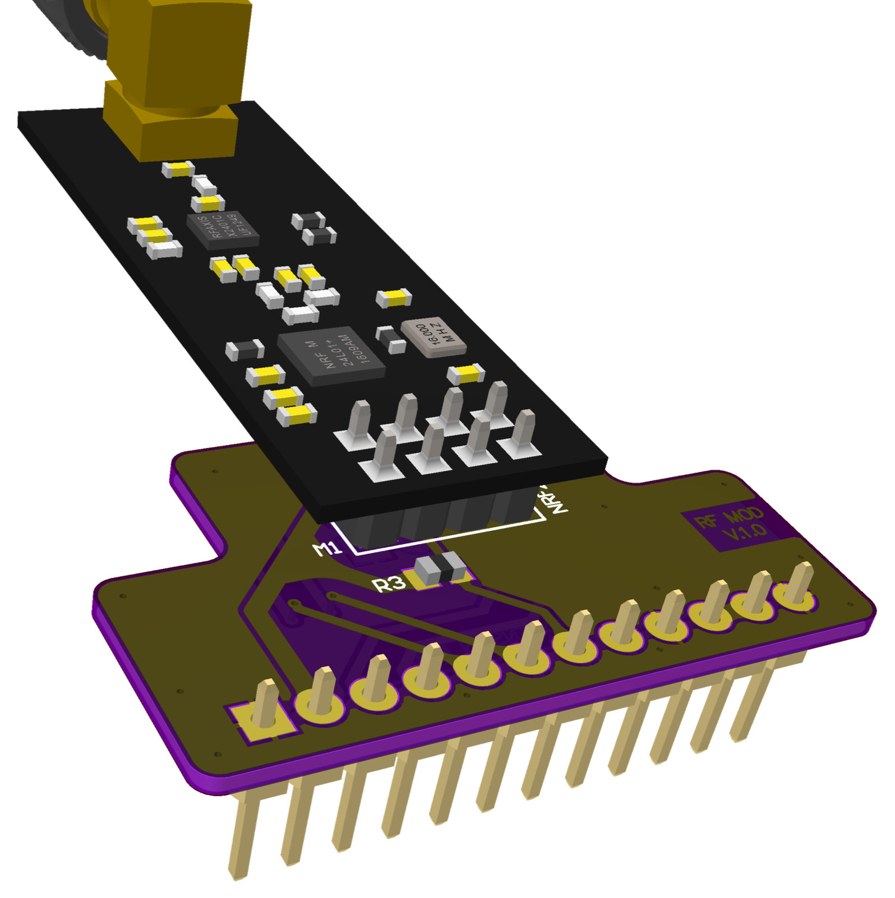
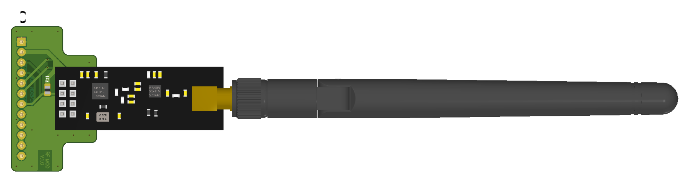

# 004 LILKA MOD RF

**Українська** | [English](README.md) · [Усі модулі](../../README.uk.md)

<br>


Плата-носій для 8-контактних (2×4, крок 2,54 мм) радіомодулів із поширеним розпиновуванням
nRF24L01. Її перевірено з двома типами модулів:

| Модуль | Діапазон | Код | Стан |
|---|---|---|---|
| nRF24L01+PA+LNA | 2,4 ГГц | [`nrf24/main.cpp`](nrf24/main.cpp) | Перевірено на залізі |
| CC1101 з розпиновуванням nRF24 | 300–348 / 387–464 / 779–928 МГц | [`cc1101/main.cpp`](cc1101/main.cpp) | Перевірено на залізі |

## Розпиновування

| Контакт роз'єму | GPIO Лілки | Сигнал носія | nRF24L01+ | CC1101 | На платі |
|---|---|---|---|---|---|
| 1, 12 | GND | GND | GND | GND | |
| 2, 11 | 3V3 | VCC | VCC | VCC | |
| 3 | 44 | RF_SCK | SCK | SCK | |
| 4 | 43 | RF_MISO | MISO | MISO / GDO1 | |
| 5 | 48 | RF_MOSI | MOSI | MOSI | |
| 6 | 47 | RF_CS# | CSN | CSN | підтяжка 10k |
| 7 | 21 | RF_RX/TX_ENABLE | CE | GDO0 | підтяжка 10k |
| 8 | 14 | RF_IRQ# | IRQ | GDO2 | підтяжка 10k |
| 9 | 13 | — | — | — | **з'єднано з GND** |
| 10 | 12 | — | — | — | **з'єднано з 3V3** |

**Ніколи не налаштовуйте GPIO13 чи GPIO12 як виходи**, поки плату вставлено: це закоротить
живлення.

## Для програмістів

- **nRF24L01+:** регістр `RPD` (несуча понад −64 дБм на вході мікросхеми) — швидкий спосіб
  перевірити приймач.
- **CC1101:** перевірений модуль читає `PARTNUM = 0x00`, `VERSION = 0x14`. GDO0 і GDO2 можна
  призначити на будь-який сигнал через `IOCFG0`/`IOCFG2`. Приклади розраховано на кварц 26 МГц,
  звичайний для таких модулів. Перевірте свій, перш ніж покладатися на точні частоти.
- Для RF24 або RadioLib: CE/GDO0 = 21, CSN = 47, IRQ/GDO2 = 14, шина SPI на SCK 44, MISO 43,
  MOSI 48.

## Приклади

```bash
pio run -e rf_nrf24  -t upload && pio device monitor
pio run -e rf_cc1101 -t upload && pio device monitor
```

- **[`nrf24`](nrf24/main.cpp):** перевіряє рівні контактів плати у спокої, SPI і зворотне читання
  регістрів, далі одну передачу разом із лінією IRQ. Щоб перевірити приймач без другого
  радіомодуля, ESP32-S3 передає кадри Wi-Fi на 13-му каналі, а nRF24 шукає несучу біля 2472 МГц.
- **[`cc1101`](cc1101/main.cpp):** перевіряє `PARTNUM`/`VERSION`, зворотне читання регістрів, обидві
  лінії GDO, далі PLL, рівень шуму на прийомі й одну передачу на 433,92 і 868,30 МГц.
