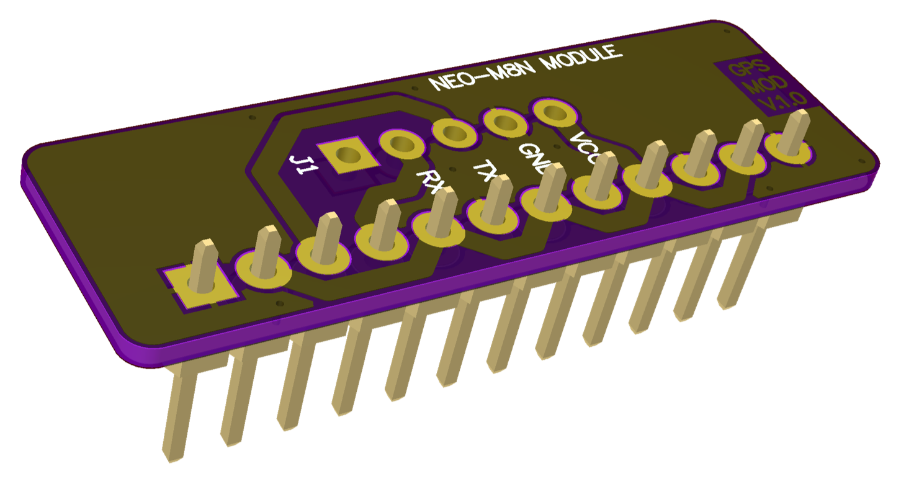

# 005 LILKA MOD GPS

[Українська](README.uk.md) | **English** · [All modules](../../README.md)



A carrier board for a u-blox NEO-M8N GNSS module, connected to the Lilka over UART. The module
plugs into the 5-pin header J1.

**Status:** no example yet; not tested on hardware.

## Pinout

| Header pin | Lilka GPIO | Signal | J1 (module) |
|---|---|---|---|
| 3 | 44 (U0RXD) | Lilka RX ← module TX | TX |
| 4 | 43 (U0TXD) | Lilka TX → module RX | RX |
| 2, 11 | 3V3 | VCC | VCC |
| 1, 12 | GND | GND | GND |
| 5, 7, 9 | 48, 21, 13 | **wired to 3V3** | |
| 6, 8, 10 | 47, 14, 12 | **wired to GND** | |

**Never configure GPIO48, 47, 21, 14, 13 or 12 as outputs** while this board is plugged in:
driving them shorts the supply.

## Usage

u-blox M8 modules send NMEA at 9600 baud, 8N1, by default:

```cpp
// RX = GPIO44, TX = GPIO43
Serial1.begin(9600, SERIAL_8N1, 44, 43);

void loop() {
    while (Serial1.available()) Serial.write(Serial1.read()); // print raw NMEA
}
```

Libraries such as TinyGPS++ (NMEA) or the SparkFun u-blox GNSS library (UBX) work on the same
`Serial1`.
