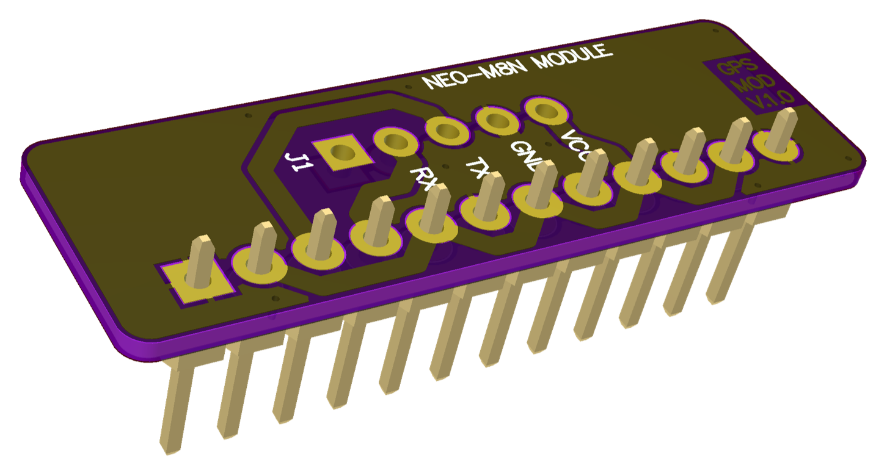

# 005 LILKA MOD GPS

**Українська** | [English](README.md) · [Усі модулі](../../README.uk.md)



Плата-носій для GNSS-модуля u-blox NEO-M8N, під'єднаного до Лілки через UART. Модуль вставляється
в 5-контактний роз'єм J1.

**Стан:** прикладу ще немає; на залізі не перевіряли.

## Розпиновування

| Контакт роз'єму | GPIO Лілки | Сигнал | J1 (модуль) |
|---|---|---|---|
| 3 | 44 (U0RXD) | RX Лілки ← TX модуля | TX |
| 4 | 43 (U0TXD) | TX Лілки → RX модуля | RX |
| 2, 11 | 3V3 | VCC | VCC |
| 1, 12 | GND | GND | GND |
| 5, 7, 9 | 48, 21, 13 | **з'єднано з 3V3** | |
| 6, 8, 10 | 47, 14, 12 | **з'єднано з GND** | |

**Ніколи не налаштовуйте GPIO48, 47, 21, 14, 13 чи 12 як виходи**, поки плату вставлено: це
закоротить живлення.

## Використання

Модулі u-blox M8 за замовчуванням передають NMEA на швидкості 9600 бод, 8N1:

```cpp
// RX = GPIO44, TX = GPIO43
Serial1.begin(9600, SERIAL_8N1, 44, 43);

void loop() {
    while (Serial1.available()) Serial.write(Serial1.read()); // вивести «сирі» NMEA
}
```

Бібліотеки на кшталт TinyGPS++ (NMEA) або SparkFun u-blox GNSS (UBX) працюють із тим самим
`Serial1`.
