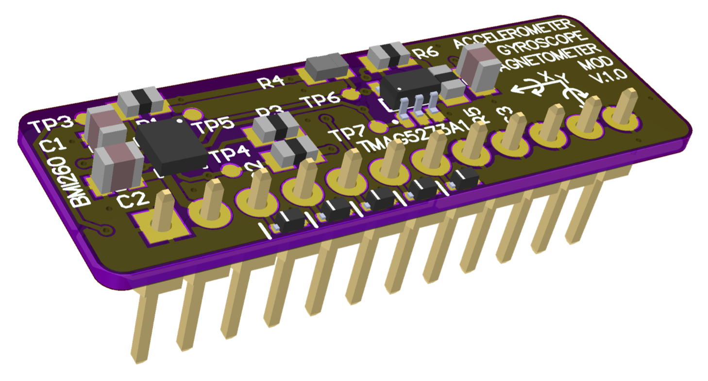

# 006 LILKA MOD GYRO MAGNET

[Українська](README.uk.md) | **English** · [All modules](../../README.md)



A motion sensor board with two chips on one I2C bus:
- **Bosch BMI260:** 3-axis accelerometer (±2–16 g) and 3-axis gyroscope (±125–2000 °/s)
- **TI TMAG5273A1:** 3-axis Hall-effect magnetometer (±40/80 mT)

**Status:** tested with [`main.cpp`](main.cpp). Everything passed except `GYR_INT2` (GPIO21), which
gave no data-ready pulses while `GYR_INT1` gave 99. The cause hasn't been found yet.

## Pinout

| Header pin | Lilka GPIO | Signal | On the board |
|---|---|---|---|
| 1, 12 | GND | GND | |
| 2, 11 | 3V3 | VCC | |
| 3 | 44 | I2C_SDA | 10k pull-up |
| 4 | 43 | I2C_SCL | 10k pull-up |
| 5 | 48 | MAG_INT# | 10k pull-up |
| 6 | 47 | GYR_INT1 | 10k pull-up |
| 7 | 21 | GYR_INT2 | 10k pull-up |
| 8, 9, 10 | 14, 13, 12 | — | **wired to GND** |

**Never configure GPIO14, 13 or 12 as outputs** while this board is plugged in: driving them
shorts the supply.

| Device | I2C address |
|---|---|
| TMAG5273A1 | `0x35` |
| BMI260 | `0x68` or `0x69` |

The BMI260 `SDO` pin goes only to test point TP5, so the board doesn't set the chip's address. The
board we tested answered at `0x69`. Scan both addresses, or solder TP5 to GND or 3V3 to fix it.

## Notes for software

- After a soft reset, the BMI260 needs Bosch's 8 KB config blob before the accelerometer and gyro
  produce data:
  1. set `PWR_CONF = 0`
  2. set `INIT_CTRL = 0`
  3. burst-write the blob to `INIT_DATA`
  4. set `INIT_CTRL = 1`
  5. wait until `INTERNAL_STATUS = 0x01`

  The blob is in [`bmi260_config/`](bmi260_config); the upload took about 230 ms at 400 kHz.
- After reset the BMI260 INT outputs are disabled. Enable them with `INT1_IO_CTRL` /
  `INT2_IO_CTRL` and map interrupts with `INT_MAP_DATA`.
- The TMAG5273 can pulse `MAG_INT#` after each conversion (`INT_CONFIG_1`). Its manufacturer ID
  reads `0x5449` ("TI").
- On our board, plugged into a Lilka, the field read about 100 µT, which is more than Earth's field
  (25–65 µT). Calibrate the hard-iron offset before using it as a compass.

## Example

```bash
pio run -e gyro_magnet -t upload && pio device monitor
```

[`main.cpp`](main.cpp) checks:
- idle levels of header pins 5–10
- both chip IDs and the BMI260 config upload
- accelerometer at rest (|a| ≈ 1 g) and gyro at rest (≈ 0 °/s)
- data-ready pulses on both BMI260 INT lines, plus forced high/low levels on each
- the TMAG5273 manufacturer ID, field magnitude and `MAG_INT#` pulses

It then prints live readings with a compass heading every 250 ms.
