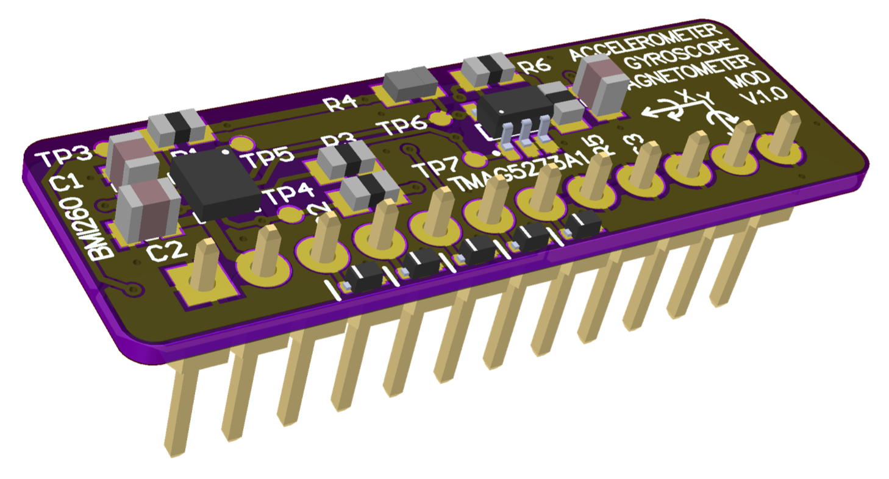

# 006 LILKA MOD GYRO MAGNET

**Українська** | [English](README.md) · [Усі модулі](../../README.uk.md)



Плата датчиків руху з двома мікросхемами на одній шині I2C:
- **Bosch BMI260:** 3-осьовий акселерометр (±2–16 g) і 3-осьовий гіроскоп (±125–2000 °/с)
- **TI TMAG5273A1:** 3-осьовий магнітометр на ефекті Холла (±40/80 мТл)

**Стан:** перевірено прикладом [`main.cpp`](main.cpp). Усе пройшло, крім `GYR_INT2` (GPIO21): він
не дав жодного імпульсу готовності даних, тоді як `GYR_INT1` дав 99. Причину ще не знайдено.

## Розпиновування

| Контакт роз'єму | GPIO Лілки | Сигнал | На платі |
|---|---|---|---|
| 1, 12 | GND | GND | |
| 2, 11 | 3V3 | VCC | |
| 3 | 44 | I2C_SDA | підтяжка 10k |
| 4 | 43 | I2C_SCL | підтяжка 10k |
| 5 | 48 | MAG_INT# | підтяжка 10k |
| 6 | 47 | GYR_INT1 | підтяжка 10k |
| 7 | 21 | GYR_INT2 | підтяжка 10k |
| 8, 9, 10 | 14, 13, 12 | — | **з'єднано з GND** |

**Ніколи не налаштовуйте GPIO14, 13 чи 12 як виходи**, поки плату вставлено: це закоротить
живлення.

| Пристрій | Адреса I2C |
|---|---|
| TMAG5273A1 | `0x35` |
| BMI260 | `0x68` або `0x69` |

Контакт `SDO` мікросхеми BMI260 виведено лише на тестову точку TP5, тому плата не задає її адресу.
Перевірена плата відповідала на `0x69`. Скануйте обидві адреси або припаяйте TP5 до GND чи 3V3,
щоб зафіксувати адресу.

## Для програмістів

- Після програмного скидання BMI260 почне видавати дані акселерометра й гіроскопа лише після
  завантаження 8-кілобайтного конфігураційного блоку від Bosch:
  1. запишіть `PWR_CONF = 0`
  2. запишіть `INIT_CTRL = 0`
  3. пакетно запишіть блок в `INIT_DATA`
  4. запишіть `INIT_CTRL = 1`
  5. дочекайтеся `INTERNAL_STATUS = 0x01`

  Блок лежить у [`bmi260_config/`](bmi260_config); завантаження на 400 кГц тривало близько 230 мс.
- Після скидання виходи INT мікросхеми BMI260 вимкнені. Увімкніть їх через `INT1_IO_CTRL` /
  `INT2_IO_CTRL`, а переривання призначте через `INT_MAP_DATA`.
- TMAG5273 може видавати імпульс на `MAG_INT#` після кожного вимірювання (`INT_CONFIG_1`). Його ID
  виробника читається як `0x5449` («TI»).
- На нашій платі, вставленій у Лілку, поле становило близько 100 мкТл — більше, ніж поле Землі
  (25–65 мкТл). Перш ніж використовувати магнітометр як компас, відкалібруйте зміщення від
  постійних магнітів (hard-iron).

## Приклад

```bash
pio run -e gyro_magnet -t upload && pio device monitor
```

[`main.cpp`](main.cpp) перевіряє:
- рівні контактів роз'єму 5–10 у спокої
- ID обох мікросхем і завантаження конфігурації BMI260
- акселерометр у спокої (|a| ≈ 1 g) і гіроскоп у спокої (≈ 0 °/с)
- імпульси готовності даних на обох лініях INT мікросхеми BMI260, а також примусові високий і
  низький рівні на кожній
- ID виробника TMAG5273, величину поля та імпульси `MAG_INT#`

Після цього щоразу через 250 мс він виводить поточні значення разом з азимутом компаса.
