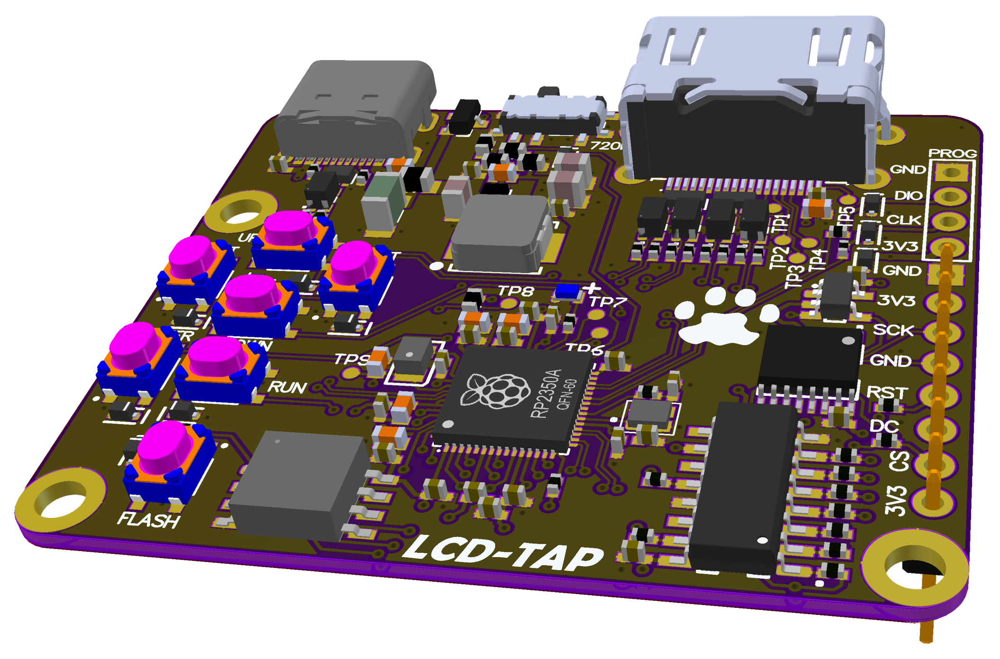

# 007 LCD-TAP

[Українська](README.uk.md) | **English** · [All modules](../../README.md)

LCD-TAP mirrors the Lilka screen to an HDMI monitor. It connects to the display bus between the
ESP32-S3 and the ST7789 panel, not to the extension connector, and rebuilds the picture as a
DVI-D (HDMI) signal: 640×480 @ 60 Hz or 1280×720 @ 30 Hz.

The firmware is in the [`lcdtap/`](lcdtap) submodule ([lilka-dev/lcdtap](https://github.com/lilka-dev/lcdtap)),
example `example/pico2_universal`.

## How it works

- **Front end:** a 74VHC4040 counter, a 74AHC1G04 inverter and a 74HC595 shift register turn the
  display SPI into an 8-bit parallel bus with a write strobe every 8 clocks.
- **Main chip:** an RP2350A takes that parallel input and generates the HDMI output.
- **Board:** USB-C for power and configuration, 5 buttons for the on-screen menu, RUN (reset),
  FLASH (BOOTSEL), a 720P resolution switch, and a PROG (SWD) header.

## Connection (J2)

| J2 pin | Signal |
|---|---|
| 1 | GND |
| 2 | 3V3 |
| 3 | LCD_SCK |
| 4 | LCD_MOSI |
| 5 | LCD_RST |
| 6 | LCD_DC |
| 7 | LCD_CS |
| 8 | 3V3 |

J2 pins 2 and 8 are on the same 3V3 rail as the board's own regulator (fed from USB-C).

> The REV01 silkscreen labels pin 4 as `GND`. The schematic netlist says pin 4 is **LCD_MOSI**.

## Setup

1. **Build** `example/pico2_universal` from `lcdtap/` with the Pico SDK (`./build.sh`). There are no
   binary releases with the Lilka preset.
2. **Flash:** hold FLASH, press RUN, then copy `lcdtap_pico2_universal.uf2` to the `RP2350` drive.
3. **Select the preset:** in the on-screen menu (ENTER), choose **Load Preset → Lilka → Apply**.
4. **Set up the Lilka display bus** in Keira:
   - **Settings → Display → Display frequency → 40 MHz**
   - **Settings → Display → Display SPI mode → SPI_MODE3**
   - Reboot the Lilka; both settings apply from the next boot.

   At the default 80 MHz, the REV01 front end can't latch the bytes reliably and the picture comes
   out garbled.
5. **Connect** J2 and HDMI, power the LCD-TAP from USB-C, then turn on the Lilka.

The full guide, with troubleshooting, is
[`LILKA.md`](https://github.com/lilka-dev/lcdtap/blob/main/LILKA.md) in the lcdtap repository.
