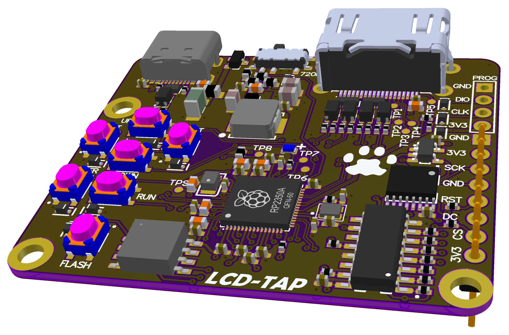

# 007 LCD-TAP

**Українська** | [English](README.md) · [Усі модулі](../../README.uk.md)

LCD-TAP виводить зображення з екрана Лілки на HDMI-монітор. Плата під'єднується до шини дисплея
між ESP32-S3 і панеллю ST7789, а не до роз'єму розширення, і відтворює картинку як сигнал DVI-D
(HDMI): 640×480 @ 60 Гц або 1280×720 @ 30 Гц.

Прошивка лежить у сабмодулі [`lcdtap/`](lcdtap) ([lilka-dev/lcdtap](https://github.com/lilka-dev/lcdtap)),
приклад `example/pico2_universal`.

## Як це працює

- **Вхідний каскад:** лічильник 74VHC4040, інвертор 74AHC1G04 і зсувний регістр 74HC595
  перетворюють SPI дисплея на 8-бітну паралельну шину зі стробом запису кожні 8 тактів.
- **Основна мікросхема:** RP2350A приймає цей паралельний вхід і формує HDMI-вихід.
- **Плата:** USB-C для живлення й налаштування, 5 кнопок для екранного меню, RUN (скидання),
  FLASH (BOOTSEL), перемикач роздільної здатності 720P і роз'єм PROG (SWD).

## Під'єднання (J2)

| Контакт J2 | Сигнал |
|---|---|
| 1 | GND |
| 2 | 3V3 |
| 3 | LCD_SCK |
| 4 | LCD_MOSI |
| 5 | LCD_RST |
| 6 | LCD_DC |
| 7 | LCD_CS |
| 8 | 3V3 |

Контакти J2 2 і 8 сидять на тій самій шині 3V3, що й власний стабілізатор плати (живиться від
USB-C).

> На шовкографії REV01 контакт 4 підписано як `GND`. За списком з'єднань схеми контакт 4 — це
> **LCD_MOSI**.

## Налаштування

1. **Зберіть** `example/pico2_universal` з `lcdtap/` за допомогою Pico SDK (`./build.sh`). Готових
   релізів із пресетом Lilka немає.
2. **Прошийте:** затисніть FLASH, натисніть RUN, потім скопіюйте `lcdtap_pico2_universal.uf2` на
   диск `RP2350`.
3. **Виберіть пресет:** в екранному меню (ENTER) виберіть **Load Preset → Lilka → Apply**.
4. **Налаштуйте шину дисплея Лілки** в Keira:
   - **Налаштування → Дисплей → Частота дисплея → 40 MHz**
   - **Налаштування → Дисплей → Режим SPI дисплея → SPI_MODE3**
   - Перезавантажте Лілку; обидва налаштування діють з наступного завантаження.

   На типових 80 МГц вхідний каскад REV01 не встигає надійно фіксувати байти, і зображення
   спотворюється.
5. **Під'єднайте** J2 і HDMI, увімкніть живлення LCD-TAP від USB-C, потім увімкніть Лілку.

Повна інструкція з розділом про проблеми —
[`LILKA.uk.md`](https://github.com/lilka-dev/lcdtap/blob/main/LILKA.uk.md) у репозиторії lcdtap.
