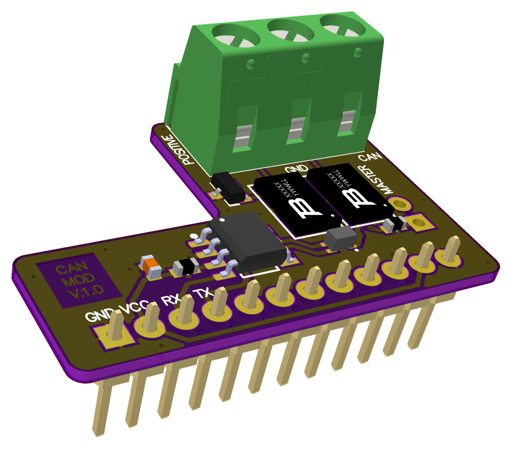

# 008 LILKA MOD CAN

[Українська](README.uk.md) | **English** · [All modules](../../README.md)



A CAN bus interface for Lilka v2. The ESP32-S3 has a built-in CAN controller (TWAI), so the board
only adds a TI SN65HVD232 3.3 V transceiver (up to 1 Mbit/s) and protection on the bus side:
- TBU-CA085 protectors on CANH and CANL
- an ACM2012 common-mode choke
- a NUP3105 TVS diode

**Status:** no example yet; not tested on hardware.

## Pinout

| Header pin | Lilka GPIO | Signal | Transceiver pin |
|---|---|---|---|
| 1, 12 | GND | GND | |
| 2, 11 | 3V3 | VCC | |
| 3 | 44 (U0RXD) | CAN RX (into Lilka) | R |
| 4 | 43 (U0TXD) | CAN TX (from Lilka) | D |
| 5–10 | — | not connected | |

| Terminal J2 | Signal |
|---|---|
| 3 (POSITIVE) | CANH |
| 2 | GND |
| 1 (NEGATIVE) | CANL |

**Termination:** J3 ("MASTER", 2 pins, not fitted) adds a 120 Ω resistor between CANH and CANL.
Close it only when this node is at one end of the bus.

## Usage (esp-idf TWAI)

This is a starting point; it hasn't been run on this board yet.

```cpp
#include <driver/twai.h>

twai_general_config_t g = TWAI_GENERAL_CONFIG_DEFAULT(GPIO_NUM_43, GPIO_NUM_44, TWAI_MODE_NORMAL);
twai_timing_config_t t = TWAI_TIMING_CONFIG_500KBITS();
twai_filter_config_t f = TWAI_FILTER_CONFIG_ACCEPT_ALL();
twai_driver_install(&g, &t, &f);
twai_start();

twai_message_t msg = {.identifier = 0x123, .data_length_code = 2, .data = {0xAB, 0xCD}};
twai_transmit(&msg, pdMS_TO_TICKS(100));
```

GPIO43 is the ESP32-S3 `U0TXD` pin, so the ROM bootloader's boot messages reach the transceiver's
TX input at every reset and appear on the bus.
