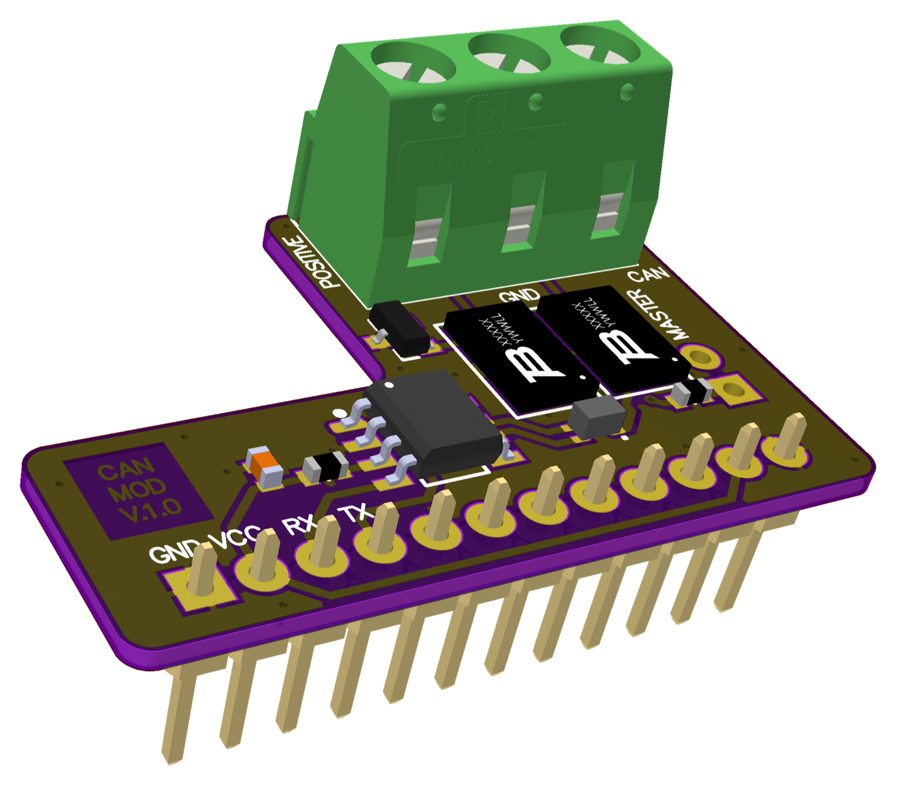

# 008 LILKA MOD CAN

**Українська** | [English](README.md) · [Усі модулі](../../README.uk.md)



Інтерфейс шини CAN для Лілки v2. ESP32-S3 має вбудований контролер CAN (TWAI), тому плата додає
лише трансивер TI SN65HVD232 на 3,3 В (до 1 Мбіт/с) і захист з боку шини:
- захисні елементи TBU-CA085 на CANH і CANL
- синфазний дросель ACM2012
- TVS-діод NUP3105

**Стан:** прикладу ще немає; на залізі не перевіряли.

## Розпиновування

| Контакт роз'єму | GPIO Лілки | Сигнал | Контакт трансивера |
|---|---|---|---|
| 1, 12 | GND | GND | |
| 2, 11 | 3V3 | VCC | |
| 3 | 44 (U0RXD) | CAN RX (у Лілку) | R |
| 4 | 43 (U0TXD) | CAN TX (з Лілки) | D |
| 5–10 | — | не під'єднані | |

| Клема J2 | Сигнал |
|---|---|
| 3 (POSITIVE) | CANH |
| 2 | GND |
| 1 (NEGATIVE) | CANL |

**Термінатор:** J3 («MASTER», 2 контакти, не встановлено) додає резистор 120 Ом між CANH і CANL.
Замикайте його лише тоді, коли цей вузол стоїть на кінці шини.

## Використання (esp-idf TWAI)

Це відправна точка; на цій платі її ще не запускали.

```cpp
#include <driver/twai.h>

twai_general_config_t g = TWAI_GENERAL_CONFIG_DEFAULT(GPIO_NUM_43, GPIO_NUM_44, TWAI_MODE_NORMAL);
twai_timing_config_t t = TWAI_TIMING_CONFIG_500KBITS();
twai_filter_config_t f = TWAI_FILTER_CONFIG_ACCEPT_ALL();
twai_driver_install(&g, &t, &f);
twai_start();

twai_message_t msg = {.identifier = 0x123, .data_length_code = 2, .data = {0xAB, 0xCD}};
twai_transmit(&msg, pdMS_TO_TICKS(100));
```

GPIO43 — це контакт `U0TXD` мікросхеми ESP32-S3, тож під час кожного скидання повідомлення
завантажувача ROM потрапляють на вхід TX трансивера і з'являються на шині.
